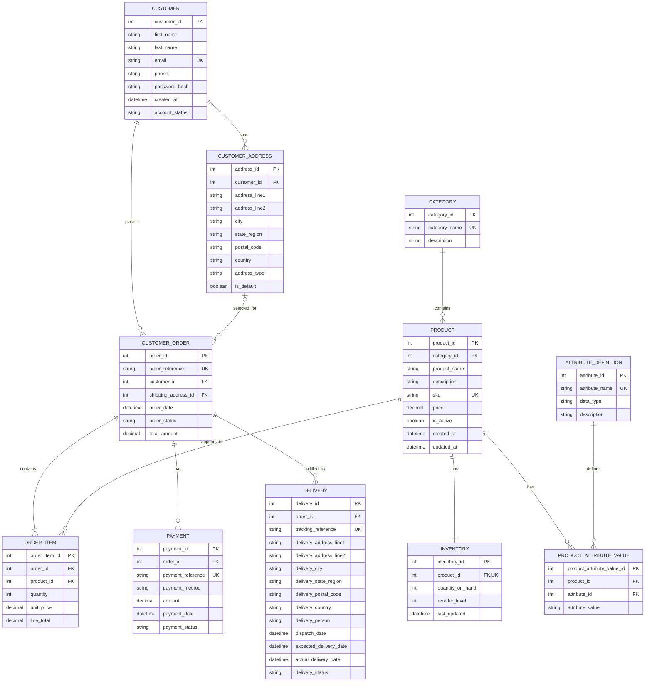

# Portfolio 1: Database Design and Modelling

## Heywizzle Limited – E-commerce Database Management System

**Student:** Adedayo Ayodele  
**Matric Number:** 2026/A/MIT/0422  
**Course:** Advanced Database System (MIT 8103)

**Project:** Heywizzle Limited – E-commerce Database Management System  

---

## Table of Contents

1. [Introduction](#1-introduction)
2. [Aim and Objectives](#2-aim-and-objectives)
3. [Scope and Design Assumptions](#3-scope-and-design-assumptions)
4. [Identification of Entities and Attributes](#4-identification-of-entities-and-attributes)
5. [Relationships and Cardinalities](#5-relationships-and-cardinalities)
6. [Entity Relationship Diagram (ERD)](#6-entity-relationship-diagram-erd)
7. [Primary Keys and Foreign Keys](#7-primary-keys-and-foreign-keys)
8. [Database Normalisation](#8-database-normalisation)
9. [Relational Database Schema](#9-relational-database-schema)
10. [Integrity Constraints and Business Rules](#10-integrity-constraints-and-business-rules)
11. [Design Decisions and Rationale](#11-design-decisions-and-rationale)
12. [Conclusion](#12-conclusion)

---

## 1. Introduction

Heywizzle Limited is an e-commerce company that operates an online platform where customers browse products, place orders, make payments, and track deliveries.

The organisation requires a well-structured database to manage products, product attributes, customers, orders, payments, inventory, and delivery records.

This portfolio presents the proposed relational database design for Heywizzle Limited. It identifies the main entities and their attributes, defines relationships, specifies primary and foreign keys, presents an Entity Relationship Diagram (ERD), applies database normalisation principles, and defines the relational schema and integrity constraints.

The design is based on the business scenario described in the main project brief. Where the scenario does not specify a detailed business rule, a reasonable design assumption is stated for review and validation.

## 2. Aim and Objectives

### 2.1 Aim

To design a reliable, consistent, and maintainable relational database structure that supports the core e-commerce operations of Heywizzle Limited.

### 2.2 Objectives

The objectives of this portfolio are to:

- Identify the data entities required by the business.
- Define suitable attributes for each entity.
- Establish relationships and cardinalities between entities.
- Assign primary keys and foreign keys.
- Model the database using an Entity Relationship Diagram.
- Apply First, Second, and Third Normal Forms (1NF, 2NF, and 3NF).
- Present the relational database schema.
- Define constraints that protect data accuracy and referential integrity.

## 3. Scope and Design Assumptions

The proposed database covers the following business operations:

- Product management.
- Product attribute management.
- Customer management.
- Order processing.
- Inventory management.
- Payment processing.
- Delivery management.

### 3.1 Design Assumptions

The following assumptions are used in the initial database design:

1. Each customer has a unique customer record and may place multiple orders.
2. Each product belongs to one product category, while a category may contain multiple products.
3. Product attributes are stored separately to support different product characteristics, such as size, colour, and brand.
4. Each order belongs to one customer and contains one or more order items.
5. Each order item records the product, quantity, and unit price at the time of purchase.
6. A product may appear in multiple order items, while each order item refers to one product.
7. Each product has one inventory record in the initial design.
8. An order may have multiple payment records, such as payment retries or instalment payments.
9. An order may have multiple delivery records to support split shipments.
10. Each delivery stores a delivery-address snapshot to preserve the original delivery destination.
11. Monetary values are stored using fixed-precision decimal data types rather than floating-point types.
12. Generated integer identifiers are used as primary keys, while human-readable order, payment, and tracking references are stored as unique values where appropriate.

These assumptions form the initial logical database design and should be confirmed against Heywizzle Limited's actual business requirements before implementation.

## 4. Identification of Entities and Attributes

An entity represents a person, object, event, or concept about which an organisation needs to store information.

The following entities have been identified for the Heywizzle Limited database.

### 4.1 Customer

Stores information about individuals who register and purchase products on the platform.

| Attribute | Description | Key |
|---|---|---|
| customer_id | Unique customer identifier | PK |
| first_name | Customer's first name | |
| last_name | Customer's surname | |
| email | Customer's email address | Unique |
| phone | Customer's phone number | |
| password_hash | Secure hash of the customer's password | |
| created_at | Date and time the account was created | |
| account_status | Current account status | |

### 4.2 CustomerAddress

Stores customer addresses separately because a customer may have multiple saved addresses.

| Attribute | Description | Key |
|---|---|---|
| address_id | Unique address identifier | PK |
| customer_id | Customer who owns the address | FK |
| address_line1 | Main address line | |
| address_line2 | Additional address information | |
| city | City or town | |
| state_region | State or region | |
| postal_code | Postal or ZIP code, where applicable | |
| country | Country | |
| address_type | For example, home or office | |
| is_default | Indicates the customer's default address | |

### 4.3 Category

Stores product categories used to organise the product catalogue.

| Attribute | Description | Key |
|---|---|---|
| category_id | Unique category identifier | PK |
| category_name | Name of the category | Unique |
| description | Category description | |

### 4.4 Product

Stores the main details of products offered for sale.

| Attribute | Description | Key |
|---|---|---|
| product_id | Unique product identifier | PK |
| category_id | Category to which the product belongs | FK |
| product_name | Product name | |
| description | Product description | |
| sku | Stock Keeping Unit | Unique |
| price | Current selling price | |
| is_active | Indicates whether the product is available for sale | |
| created_at | Date and time the product was added | |
| updated_at | Date and time the product was last updated | |

### 4.5 AttributeDefinition

Defines the types of attributes that products can have, such as colour, size, brand, or material.

| Attribute | Description | Key |
|---|---|---|
| attribute_id | Unique attribute identifier | PK |
| attribute_name | Attribute name | Unique |
| data_type | Expected value type, such as text or number | |
| description | Explanation of the attribute | |

### 4.6 ProductAttributeValue

Associates a product with an attribute and its corresponding value. This allows products in different categories to have different characteristics.

| Attribute | Description | Key |
|---|---|---|
| product_attribute_value_id | Unique product-attribute value identifier | PK |
| product_id | Product being described | FK |
| attribute_id | Attribute being assigned | FK |
| attribute_value | Value of the product attribute | |

### 4.7 Inventory

Stores the current stock quantity for each product.

| Attribute | Description | Key |
|---|---|---|
| inventory_id | Unique inventory record identifier | PK |
| product_id | Product whose stock is recorded | FK, Unique |
| quantity_on_hand | Current quantity held in stock | |
| reorder_level | Stock level at which replenishment should be considered | |
| last_updated | Date and time the stock record was updated | |

### 4.8 CustomerOrder

Stores the overall details of an order placed by a customer.

The table is named `customer_order` to avoid using the SQL reserved word `ORDER`.

| Attribute | Description | Key |
|---|---|---|
| order_id | Unique internal order identifier | PK |
| order_reference | Customer-facing order reference | Unique |
| customer_id | Customer who placed the order | FK |
| order_date | Date and time the order was placed | |
| order_status | Current order status | |
| shipping_address_id | Saved address selected at checkout, where applicable | FK, Nullable |
| total_amount | Total amount recorded for the order | |

### 4.9 OrderItem

Stores individual products included in an order. This entity resolves the many-to-many relationship between orders and products.

| Attribute | Description | Key |
|---|---|---|
| order_item_id | Unique order-item identifier | PK |
| order_id | Order to which the item belongs | FK |
| product_id | Product purchased | FK |
| quantity | Number of units ordered | |
| unit_price | Product price at the time of purchase | |
| line_total | Quantity multiplied by unit price | |

### 4.10 Payment

Stores payment attempts and payment transactions associated with customer orders.

| Attribute | Description | Key |
|---|---|---|
| payment_id | Unique payment identifier | PK |
| order_id | Order being paid for | FK |
| payment_reference | Unique payment transaction reference | Unique |
| payment_method | Method used to make payment | |
| amount | Amount for this payment record | |
| payment_date | Date and time of payment attempt or receipt | |
| payment_status | Payment transaction status | |

### 4.11 Delivery

Stores delivery and shipment information for customer orders.

| Attribute | Description | Key |
|---|---|---|
| delivery_id | Unique delivery identifier | PK |
| order_id | Order being delivered | FK |
| tracking_reference | Unique delivery tracking reference | Unique |
| delivery_address_line1 | Delivery address snapshot | |
| delivery_address_line2 | Additional address information | |
| delivery_city | Delivery city or town | |
| delivery_state_region | Delivery state or region | |
| delivery_postal_code | Postal code, where applicable | |
| delivery_country | Delivery country | |
| delivery_person | Name or identifier of assigned delivery personnel | |
| dispatch_date | Date the delivery was dispatched | |
| expected_delivery_date | Expected delivery date | |
| actual_delivery_date | Date delivery was completed | |
| delivery_status | Current delivery status | |

## 5. Relationships and Cardinalities

Relationships define how records in different entities are connected. Cardinality specifies the number of records that can participate in a relationship.

The following relationships have been identified:

| Relationship | Cardinality | Explanation |
|---|---|---|
| Customer — CustomerAddress | 1:M | One customer may save several addresses; each address belongs to one customer. |
| Customer — CustomerOrder | 1:M | One customer may place many orders; each order belongs to one customer. |
| Category — Product | 1:M | One category may contain many products; each product belongs to one category. |
| Product — Inventory | 1:1 | Each product has one inventory record in this design. |
| Product — ProductAttributeValue | 1:M | One product may have several attribute values. |
| AttributeDefinition — ProductAttributeValue | 1:M | One attribute definition may be used for many products. |
| CustomerOrder — OrderItem | 1:M | One order contains one or more order items. |
| Product — OrderItem | 1:M | One product may appear in many order items. |
| CustomerOrder — Payment | 1:M | One order may have multiple payment records. |
| CustomerOrder — Delivery | 1:M | One order may be fulfilled through multiple deliveries. |
| CustomerAddress — CustomerOrder | 1:M (Optional) | A saved address may be selected for many orders; an order may reference a saved address. |

**Important design considerations:**

- The many-to-many relationship between `CustomerOrder` and `Product` is resolved through the `OrderItem` entity.
- The many-to-many relationship between `Product` and attribute definitions is resolved through `ProductAttributeValue`.

## 6. Entity Relationship Diagram (ERD)

The following Mermaid Entity Relationship Diagram represents the proposed logical database structure.

GitHub supports Mermaid diagrams in Markdown files. The diagram can therefore be rendered directly within the project repository.



## 7. Primary Keys and Foreign Keys

### 7.1 Primary Keys

A primary key uniquely identifies each record in a database table.

The proposed primary keys are:

| Table | Primary Key |
|---|---|
| Customer | customer_id |
| CustomerAddress | address_id |
| Category | category_id |
| Product | product_id |
| AttributeDefinition | attribute_id |
| ProductAttributeValue | product_attribute_value_id |
| Inventory | inventory_id |
| CustomerOrder | order_id |
| OrderItem | order_item_id |
| Payment | payment_id |
| Delivery | delivery_id |

### 7.2 Foreign Keys

Foreign keys establish relationships between tables and help prevent records from referring to non-existent parent records.

| Table | Foreign Key | References |
|---|---|---|
| CustomerAddress | customer_id | Customer(customer_id) |
| Product | category_id | Category(category_id) |
| ProductAttributeValue | product_id | Product(product_id) |
| ProductAttributeValue | attribute_id | AttributeDefinition(attribute_id) |
| Inventory | product_id | Product(product_id) |
| CustomerOrder | customer_id | Customer(customer_id) |
| CustomerOrder | shipping_address_id | CustomerAddress(address_id) |
| OrderItem | order_id | CustomerOrder(order_id) |
| OrderItem | product_id | Product(product_id) |
| Payment | order_id | CustomerOrder(order_id) |
| Delivery | order_id | CustomerOrder(order_id) |

**Note:** The `shipping_address_id` field is nullable because an order may use an address entered during checkout rather than an address previously saved to the customer's account. The `Delivery` table retains the actual delivery-address snapshot.

## 8. Database Normalisation

Normalisation is the process of structuring database tables to reduce unnecessary data duplication and prevent insertion, update, and deletion anomalies.

The proposed database design applies the first three normal forms: 1NF, 2NF, and 3NF.

### 8.1 First Normal Form (1NF)

A table is in First Normal Form when:

- Each column contains a single, atomic value.
- There are no repeating groups or arrays of values in a row.
- Each row can be uniquely identified.

**Application to Heywizzle Limited:**

Customer phone and email details are stored as individual values. Products in an order are not stored as a comma-separated list in the order record. Instead, each purchased product is stored as a separate row in `OrderItem`.

Similarly, product characteristics are stored as individual rows in `ProductAttributeValue`, rather than placing several attributes in one multi-value column.

### 8.2 Second Normal Form (2NF)

A table is in Second Normal Form when:

- It is already in 1NF.
- Every non-key attribute depends on the whole candidate key, not just part of a composite key.

**Application to Heywizzle Limited:**

The design uses a single-column primary key for each table.

In `OrderItem`, the order identifier, product identifier, quantity, and purchase-time unit price describe an individual order line. Product descriptions and category names are kept in `Product` and `Category`, rather than being repeated in every order item.

This avoids partial dependency and unnecessary repetition of product information in order records.

### 8.3 Third Normal Form (3NF)

A table is in Third Normal Form when:

- It is already in 2NF.
- Non-key attributes depend on the key, the whole key, and nothing but the key.
- Non-key attributes do not depend transitively on another non-key attribute.

**Application to Heywizzle Limited:**

Product category descriptions are stored in `Category`, not repeated in `Product`.

Attribute names and definitions are stored in `AttributeDefinition`, while the values assigned to individual products are stored in `ProductAttributeValue`.

Customer addresses are stored in `CustomerAddress`, rather than repeating all address details in the customer record.

Payment details and delivery details are also stored in their respective tables rather than being mixed into the order table.

**Normalisation outcome:** The proposed structure separates distinct business subjects into related tables and reduces avoidable data duplication.

Some values, such as `CustomerOrder.total_amount` and `OrderItem.line_total`, may be retained as controlled totals for operational or reporting purposes. If stored, they must be calculated and validated against the order items to prevent inconsistencies.

## 9. Relational Database Schema

The following notation summarises the proposed relational database schema.

- **PK:** Primary Key
- **FK:** Foreign Key
- **UK:** Unique Key

```sql
CUSTOMER (
    customer_id PK,
    first_name,
    last_name,
    email UK,
    phone,
    password_hash,
    created_at,
    account_status
);

CUSTOMER_ADDRESS (
    address_id PK,
    customer_id FK -> CUSTOMER.customer_id,
    address_line1,
    address_line2,
    city,
    state_region,
    postal_code,
    country,
    address_type,
    is_default
);

CATEGORY (
    category_id PK,
    category_name UK,
    description
);

PRODUCT (
    product_id PK,
    category_id FK -> CATEGORY.category_id,
    product_name,
    description,
    sku UK,
    price,
    is_active,
    created_at,
    updated_at
);

ATTRIBUTE_DEFINITION (
    attribute_id PK,
    attribute_name UK,
    data_type,
    description
);

PRODUCT_ATTRIBUTE_VALUE (
    product_attribute_value_id PK,
    product_id FK -> PRODUCT.product_id,
    attribute_id FK -> ATTRIBUTE_DEFINITION.attribute_id,
    attribute_value
);

INVENTORY (
    inventory_id PK,
    product_id FK -> PRODUCT.product_id UK,
    quantity_on_hand,
    reorder_level,
    last_updated
);

CUSTOMER_ORDER (
    order_id PK,
    order_reference UK,
    customer_id FK -> CUSTOMER.customer_id,
    shipping_address_id FK -> CUSTOMER_ADDRESS.address_id,
    order_date,
    order_status,
    total_amount
);

ORDER_ITEM (
    order_item_id PK,
    order_id FK -> CUSTOMER_ORDER.order_id,
    product_id FK -> PRODUCT.product_id,
    quantity,
    unit_price,
    line_total
);

PAYMENT (
    payment_id PK,
    order_id FK -> CUSTOMER_ORDER.order_id,
    payment_reference UK,
    payment_method,
    amount,
    payment_date,
    payment_status
);

DELIVERY (
    delivery_id PK,
    order_id FK -> CUSTOMER_ORDER.order_id,
    tracking_reference UK,
    delivery_address_line1,
    delivery_address_line2,
    delivery_city,
    delivery_state_region,
    delivery_postal_code,
    delivery_country,
    delivery_person,
    dispatch_date,
    expected_delivery_date,
    actual_delivery_date,
    delivery_status
);
```

## 10. Integrity Constraints and Business Rules

Integrity constraints ensure that only valid and consistent data is stored in the database.

### 10.1 Entity Integrity

- Every table must have a primary key.
- Primary key values must be unique and must not be NULL.
- Every product, customer, order, payment, and delivery record must have its own identifier.

### 10.2 Referential Integrity

The following referential integrity rules will apply:

- A customer address must reference an existing customer.
- A product must reference an existing category.
- An order must reference an existing customer.
- An order item must reference an existing order and product.
- A payment must reference an existing order.
- A delivery must reference an existing order.
- A product attribute value must reference an existing product and attribute definition.
- An inventory record must reference an existing product.

### 10.3 Domain Constraints

The following validation rules are proposed:

| Field | Constraint |
|---|---|
| Customer.email | Must be unique and not NULL |
| Product.sku | Must be unique and not NULL |
| Product.price | Must be greater than or equal to zero |
| Inventory.quantity_on_hand | Must be greater than or equal to zero |
| Inventory.reorder_level | Must be greater than or equal to zero |
| OrderItem.quantity | Must be greater than zero |
| OrderItem.unit_price | Must be greater than or equal to zero |
| Payment.amount | Must be greater than zero for an actual payment transaction |
| OrderItem.line_total | Must equal quantity multiplied by unit_price |
| CustomerOrder.total_amount | Must agree with the sum of order-item line totals, subject to separately defined discounts, tax, or delivery charges |

### 10.4 Unique Constraints

The following values should be unique:

- Customer email address.
- Category name.
- Product SKU.
- Attribute name.
- Customer order reference.
- Payment reference.
- Delivery tracking reference.
- Inventory product_id, to enforce one inventory record per product.

### 10.5 Status Constraints

Status fields should accept only values defined by the application.

The following initial values are proposed:

| Status Field | Allowed Values |
|---|---|
| Account Status | active, inactive, suspended |
| Order Status | pending, confirmed, processing, shipped, completed, cancelled |
| Payment Status | pending, successful, failed, refunded |
| Delivery Status | pending, dispatched, in_transit, delivered, failed, returned |

These values are proposed examples and should be confirmed against the company's actual business workflow.

### 10.6 Deletion and Update Rules

- A customer should not be physically deleted while related orders or financial records must be retained. Account deactivation is preferable.
- A category should not be deleted while products still reference it.
- A product referenced by historical order items should normally be deactivated rather than deleted.
- An order should not be deleted merely because a payment failed; its status and payment history should be retained.
- Foreign-key update and delete actions should be selected deliberately. `RESTRICT` or `NO ACTION` is appropriate for important historical records. Cascading deletion should be limited to dependent records where deletion is genuinely permitted.

## 11. Design Decisions and Rationale

The following design decisions were made to support the operational requirements of Heywizzle Limited.

| Design Decision | Rationale |
|---|---|
| Separate order and order-item tables | An order can contain multiple products. Separating the order header from its line items avoids repeating order-level information. |
| Separate product attributes | Different product categories may require different characteristics. Attribute definitions and product attribute values provide flexibility without creating a new database column for every possible characteristic. |
| Separate inventory records | Stock quantities can be updated independently of product descriptions and prices. |
| Purchase-time unit price | The order item stores the price charged when the order was placed, preserving historical transaction information. |
| Separate payment records | Multiple payment attempts or transactions can be associated with one order. |
| Separate delivery records | An order can be split into multiple shipments, each with its own tracking reference and status. |
| Delivery address snapshot | The delivery destination remains historically accurate even if the customer's saved address changes. |

## 12. Conclusion

This portfolio has proposed a relational database design for Heywizzle Limited, an e-commerce platform that manages products, customers, orders, payments, inventory, and delivery records.

The design identifies the required entities and attributes, establishes relationships and cardinalities, defines primary and foreign keys, and presents an Entity Relationship Diagram and relational schema.

It also applies First, Second, and Third Normal Forms (1NF, 2NF, and 3NF) and specifies integrity constraints to support accurate and consistent data management.

The proposed design provides a foundation for implementing the Heywizzle Limited database. It can subsequently be used for:

- **Portfolio 2:** Query Processing and Optimisation.
- **Portfolio 3:** Transactions and Concurrency.
- **Portfolio 4:** NoSQL and Advanced Data Models.
- **Portfolio 5:** Distributed and Cloud Database Exercise.


