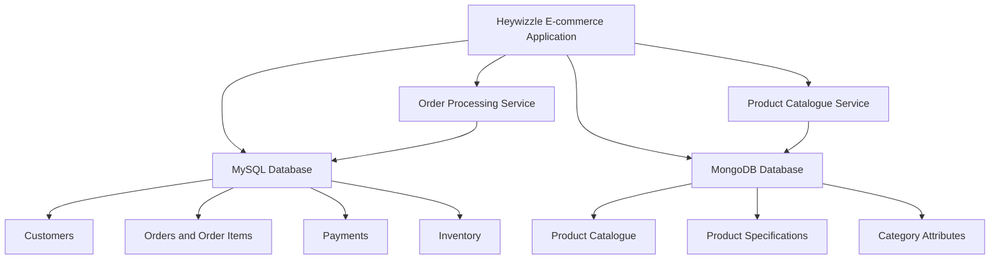

# Portfolio 4: NoSQL and Advanced Data Models

## Heywizzle Limited – E-commerce Database Management System

**Student:** Adedayo Ayodele  
**Matric Number:** 2026/A/MIT/0422  
**Course:** Advanced Database System (MIT 8103)  
**Portfolio:** 4 – NoSQL and Advanced Data Models  
**Relational DBMS:** MySQL  
**NoSQL DBMS:** MongoDB

---

## 1. Introduction

Heywizzle Limited operates an e-commerce platform that manages products, customers, orders, payments, inventory, and delivery records. The relational database developed in the earlier portfolios provides a structured approach to storing and managing this information.

However, e-commerce platforms often contain product information that varies significantly between categories. For example, clothing products may require attributes such as size, colour, and material, while electronic products may require specifications such as screen size, processor type, storage capacity, and battery life.

Representing these varying attributes in a traditional relational database can require additional tables, complex relationships, or frequent schema modifications.

NoSQL databases provide alternative data models that can support flexible data structures and different application requirements. This portfolio explores document-oriented databases, key-value data models, and other NoSQL approaches using the Heywizzle Limited e-commerce system as a case study.

MongoDB is introduced as a document-oriented database for storing flexible product information, while MySQL remains the relational database used for structured business data such as customers, orders, payments, and inventory.

The portfolio examines how relational and NoSQL databases can complement each other to improve flexibility, scalability, and data management.

## 2. Aim and Objectives

### Aim

To explore NoSQL databases and advanced data models and evaluate their suitability for managing flexible and scalable product information within the Heywizzle Limited e-commerce system.

### Objectives

- Explore document-oriented databases and their characteristics.
- Model product information using flexible document structures.
- Store product attributes that vary between product categories.
- Explore key-value and other NoSQL data models.
- Compare relational and NoSQL database approaches.
- Examine the benefits of NoSQL databases for scalability and flexibility.
- Demonstrate how MySQL and MongoDB can complement each other in an e-commerce environment.

## 3. Overview of NoSQL Databases

NoSQL refers to database technologies that provide data models beyond the traditional relational table-based approach.

NoSQL databases are designed to support different data structures, application requirements, and scaling strategies.

Unlike relational databases, which generally use predefined schemas and tables, many NoSQL databases support flexible or evolving data structures.

### 3.1 Characteristics of NoSQL Databases

The major characteristics of NoSQL databases include:

- **Flexible data models:** Data structures can vary between records.
- **Scalability:** Many NoSQL systems support horizontal scaling across multiple servers.
- **Application-specific data structures:** Data can be organised according to how applications access it.
- **Distributed architecture:** Some NoSQL systems support replication and distributed data storage.
- **High-volume data management:** NoSQL databases can be suitable for applications involving large amounts of rapidly changing data.

These characteristics make NoSQL databases useful for applications such as product catalogues, user preferences, content management, and distributed applications.

## 4. Document-Oriented Databases

A document-oriented database stores data as documents rather than traditional relational rows.

Documents commonly use JSON-like structures containing fields, values, arrays, and nested objects.

MongoDB is an example of a document-oriented database. It stores documents in collections, which provide a logical grouping of related documents.

### 4.1 MongoDB Data Model

The following concepts are used in MongoDB:

| MongoDB Concept | Description | Heywizzle Application |
|---|---|---|
| Database | A logical container for collections. | `heywizzle` |
| Collection | A group of related documents. | `products` |
| Document | A record containing fields and values. | An individual product |
| Field | A named attribute within a document. | `product_name` |
| Embedded document | A nested document within another document. | Product specifications |
| Array | A collection of values within a document. | Product images or available sizes |

### 4.2 Benefits of Document-Oriented Databases

Document-oriented databases provide several advantages for e-commerce applications:

1. Product attributes can vary between categories.
2. Related product information can be stored together.
3. Nested structures can represent complex product specifications.
4. New product attributes can be introduced without modifying a fixed relational schema.
5. Documents can be retrieved efficiently when the application commonly accesses the complete product information.

These benefits make MongoDB suitable for managing the flexible product catalogue of Heywizzle Limited.

## 5. Modelling Product Information Using MongoDB

### 5.1 Product Information Requirements

The Heywizzle Limited product catalogue contains different categories of products.

Examples include:

- Clothing: size, colour, material, and gender category.
- Electronics: brand, storage capacity, screen size, and processor.
- Furniture: dimensions, material, weight, and assembly requirements.
- Accessories: colour, material, compatibility, and design.

A relational model may require separate attribute tables or category-specific relationships to represent these differences.

A document-oriented model can store the common product fields alongside category-specific attributes.

### 5.2 MongoDB Product Document Structure

The following example demonstrates a clothing product stored as a MongoDB document.

```javascript
{
  _id: ObjectId("674abc123456789012345678"),
  product_id: 101,
  product_name: "Classic Cotton T-Shirt",
  category: "Clothing",
  brand: "Heywizzle",
  description: "A comfortable cotton T-shirt.",
  price: 25.00,
  currency: "USD",
  stock_quantity: 50,
  attributes: {
    size: ["S", "M", "L", "XL"],
    colour: ["Black", "White", "Blue"],
    material: "Cotton",
    gender: "Unisex"
  },
  images: [
    "tshirt-front.jpg",
    "tshirt-back.jpg"
  ],
  is_active: true
}
```

The `attributes` field contains category-specific information. This structure allows clothing products to store their unique characteristics without requiring every product to have the same fields.

### 5.3 Modelling an Electronic Product

An electronic product can use the same general document structure while containing different attributes.

```javascript
{
  product_id: 102,
  product_name: "Smartphone X",
  category: "Electronics",
  brand: "TechBrand",
  price: 499.99,
  currency: "USD",
  stock_quantity: 20,
  attributes: {
    screen_size: "6.5 inches",
    storage_capacity: "256GB",
    processor: "Octa-core",
    battery_capacity: "5000mAh",
    operating_system: "Android"
  },
  is_active: true
}
```

The electronic product does not require clothing attributes such as size or material.

This demonstrates how MongoDB supports flexible product structures within the same collection.

### 5.4 Modelling a Furniture Product

```javascript
{
  product_id: 103,
  product_name: "Modern Office Chair",
  category: "Furniture",
  brand: "Heywizzle Home",
  price: 150.00,
  currency: "USD",
  stock_quantity: 15,
  attributes: {
    material: "Leather",
    colour: "Black",
    dimensions: {
      height: "120cm",
      width: "65cm",
      depth: "60cm"
    },
    adjustable: true,
    assembly_required: true
  },
  is_active: true
}
```

The nested `dimensions` object demonstrates how document databases can represent complex attributes.

## 6. MongoDB Implementation

### 6.1 Creating the Database and Collection

The following commands create the Heywizzle MongoDB database and product collection.

```javascript
use heywizzle

db.createCollection("products")
```

MongoDB creates the database when data is first stored in it.

### 6.2 Inserting Product Documents

The following command inserts a clothing product.

```javascript
db.products.insertOne({
  product_id: 101,
  product_name: "Classic Cotton T-Shirt",
  category: "Clothing",
  price: 25.00,
  stock_quantity: 50,
  attributes: {
    size: ["S", "M", "L", "XL"],
    colour: ["Black", "White"],
    material: "Cotton"
  }
})
```

An electronic product can be inserted into the same collection.

```javascript
db.products.insertOne({
  product_id: 102,
  product_name: "Smartphone X",
  category: "Electronics",
  price: 499.99,
  stock_quantity: 20,
  attributes: {
    storage_capacity: "256GB",
    screen_size: "6.5 inches",
    processor: "Octa-core"
  }
})
```

### 6.3 Retrieving Products

Retrieve all products:

```javascript
db.products.find()
```

Retrieve clothing products:

```javascript
db.products.find({
  category: "Clothing"
})
```

Retrieve products within a price range:

```javascript
db.products.find({
  price: {
    $gte: 20,
    $lte: 100
  }
})
```

Retrieve products with a particular attribute:

```javascript
db.products.find({
  "attributes.material": "Cotton"
})
```

### 6.4 Updating Product Information

The following command updates the price of a product.

```javascript
db.products.updateOne(
  {
    product_id: 101
  },
  {
    $set: {
      price: 30.00
    }
  }
)
```

Add a new product attribute:

```javascript
db.products.updateOne(
  {
    product_id: 101
  },
  {
    $set: {
      "attributes.pattern": "Plain"
    }
  }
)
```

This demonstrates how additional attributes can be introduced without modifying a predefined table structure.

### 6.5 Creating Indexes

Indexes can improve the performance of product searches.

```javascript
db.products.createIndex({
  product_id: 1
}, {
  unique: true
})
```

Create an index for category-based searches:

```javascript
db.products.createIndex({
  category: 1
})
```

Create a compound index for category and price queries:

```javascript
db.products.createIndex({
  category: 1,
  price: 1
})
```

Indexes should be selected based on the application's actual query patterns because they also introduce storage and update overhead.

## 7. Exploring Key-Value and Other NoSQL Data Models

NoSQL databases support several data models, each designed for different requirements.

### 7.1 Key-Value Data Model

A key-value database stores data as a collection of unique keys and their associated values.

Example:

```text
Key: customer:1001:cart
Value: {
  product_id: 101,
  quantity: 2
}
```

Key-value databases are suitable for:

- Shopping carts.
- User session management.
- Temporary application data.
- Caching frequently accessed information.

Redis is an example of a key-value database.

### 7.2 Column-Family Data Model

Column-family databases organise data into column families rather than traditional relational tables.

They are designed for distributed storage and large-scale data processing.

Examples include:

- Apache Cassandra.
- Apache HBase.

Potential applications within Heywizzle include large-scale activity records, product interaction data, and distributed event storage.

### 7.3 Graph Data Model

Graph databases represent information using nodes, relationships, and properties.

They are useful when relationships between entities are central to the application's queries.

Example:

```text
Customer A
   |
   | purchased
   v
Product 101
   |
   | belongs to
   v
Clothing Category
```

Graph databases could support product recommendations, customer relationship analysis, and product association queries.

Neo4j is an example of a graph database.

## 8. Comparison of Relational and NoSQL Databases

The following comparison considers MySQL and MongoDB within the Heywizzle Limited e-commerce system.

| Feature | MySQL | MongoDB |
|---|---|---|
| Data model | Relational tables | Document-oriented |
| Data structure | Rows and columns | BSON documents |
| Schema | Generally predefined | Flexible |
| Relationships | Foreign keys and joins | Embedded documents and references |
| Product attributes | Structured tables or attribute relationships | Flexible nested attributes |
| Transactions | ACID transactions | ACID transactions supported |
| Scalability | Vertical and horizontal options | Horizontal scaling through sharding |
| Data consistency | Strong transactional consistency | Configurable consistency and transactional support |
| Suitable application | Orders, payments, customers, inventory | Flexible product catalogues and product specifications |

### 8.1 Advantages of MySQL

MySQL provides:

- Structured data management.
- Referential integrity through foreign keys.
- ACID transaction support.
- Reliable order and payment processing.
- SQL-based querying and reporting.
- Strong consistency for transactional business operations.

These characteristics make MySQL suitable for managing the core transactional operations of Heywizzle Limited.

### 8.2 Advantages of MongoDB

MongoDB provides:

- Flexible product document structures.
- Support for nested product attributes.
- Reduced need for category-specific schema modifications.
- Document-oriented data retrieval.
- Horizontal scaling through sharding.
- Flexible storage of product descriptions and specifications.

These characteristics make MongoDB suitable for product catalogue management.

## 9. Proposed Hybrid Database Architecture

Heywizzle Limited can use a hybrid database architecture in which MySQL and MongoDB serve different purposes.

MySQL remains responsible for structured transactional information, while MongoDB stores flexible product catalogue information.

### 9.1 Proposed Database Responsibilities

| Data | Database | Reason |
|---|---|---|
| Customers | MySQL | Structured customer records |
| Orders | MySQL | Transactional integrity |
| Order items | MySQL | Relationships between orders and products |
| Payments | MySQL | Transactional financial records |
| Inventory | MySQL | Reliable stock reservation |
| Product catalogue | MongoDB | Flexible product attributes |
| Product specifications | MongoDB | Category-specific document structures |
| Product descriptions | MongoDB | Flexible content storage |

### 9.2 Hybrid Architecture Diagram



### 9.3 Benefits of the Hybrid Approach

The hybrid architecture provides several benefits:

1. MySQL maintains the integrity of structured transactional data.
2. MongoDB supports flexible product information.
3. Product categories can introduce new attributes without extensive relational schema changes.
4. Each database can be optimised for its specific workload.
5. The system can scale different components according to their requirements.

However, using two databases introduces additional complexity, including data synchronisation, application integration, operational monitoring, and consistency management.

The hybrid approach should therefore be adopted when the benefits justify the additional infrastructure and development effort.

## 10. Scalability and Flexibility

### 10.1 Horizontal Scalability

Horizontal scalability involves adding more servers or nodes to distribute data and workload.

MongoDB supports horizontal scaling through sharding.

Sharding distributes documents across multiple shards according to a selected shard key.

For example, a large product catalogue could be distributed across several MongoDB shards.

This can help support increasing product volumes and application workloads.

### 10.2 Flexible Schema

A flexible schema allows documents within the same collection to contain different fields.

For Heywizzle Limited, this means:

- Clothing products can store sizes and materials.
- Electronics can store technical specifications.
- Furniture can store dimensions and assembly information.
- New categories can introduce additional attributes.

This flexibility reduces the need for frequent schema modifications.

### 10.3 Considerations and Limitations

NoSQL databases are not automatically better than relational databases.

Potential limitations include:

- Data duplication.
- More complex relationships.
- Additional application-level validation.
- Challenges in maintaining consistency across databases.
- Increased operational complexity in distributed deployments.

The appropriate database model should be selected based on the application's data structure, access patterns, consistency requirements, and scalability needs.

## 11. Testing and Evaluation

The MongoDB implementation can be evaluated using the following tests.

| Test | Procedure | Expected Result |
|---|---|---|
| Test 1: Document insertion | Insert clothing and electronic product documents. | Both documents are stored successfully. |
| Test 2: Flexible attributes | Insert products with different category-specific attributes. | Documents can contain different attribute structures. |
| Test 3: Product retrieval | Retrieve products by category. | Matching documents are returned. |
| Test 4: Attribute filtering | Search for products using nested attributes. | Matching products are returned. |
| Test 5: Product update | Add a new attribute to an existing product. | The document is updated successfully. |
| Test 6: Indexing | Create indexes on product ID and category. | Indexes are created and can support relevant queries. |
| Test 7: Relational comparison | Compare MySQL and MongoDB product representations. | Differences in schema flexibility and data modelling are demonstrated. |

The tests should be performed using a test database. Screenshots or exported query results should be included as evidence of the implementation.

## 12. Security and Reliability Considerations

The following practices should be considered when implementing MongoDB and MySQL:

- Enable database authentication.
- Use role-based access control.
- Restrict database access to authorised applications.
- Validate product data before inserting documents.
- Use appropriate indexes for frequently executed queries.
- Maintain database backups.
- Monitor database performance and storage utilisation.
- Use transactions where multiple related operations must succeed together.
- Avoid storing sensitive customer or payment information unnecessarily.
- Ensure that the application handles database connection failures appropriately.

MongoDB's flexible schema does not eliminate the need for data validation. Consistent field names, data types, and business rules remain important.

## 13. Conclusion

This portfolio explored NoSQL databases and advanced data models within the Heywizzle Limited e-commerce system.

MongoDB was introduced as a document-oriented database capable of storing product information using flexible document structures. The portfolio demonstrated how different product categories can contain different attributes without requiring a fixed relational schema.

Key-value, column-family, and graph data models were also examined to demonstrate the range of NoSQL approaches and their potential applications.

The comparison between MySQL and MongoDB highlighted the strengths of relational databases in transactional integrity and the strengths of document-oriented databases in flexible data modelling.

A hybrid database architecture was proposed in which MySQL manages customers, orders, payments, and inventory, while MongoDB manages the flexible product catalogue.

This approach demonstrates how relational and NoSQL databases can complement each other to support the scalability, flexibility, and reliability requirements of an e-commerce platform.
